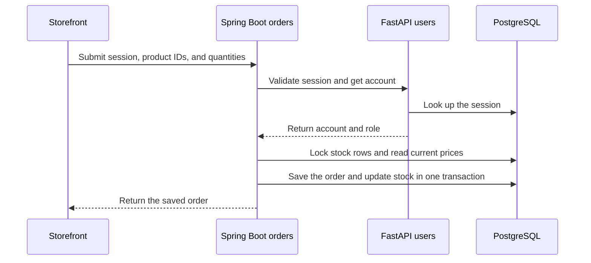

# Apex system architecture

The storefront consumes three JSON APIs. Each backend service has a separate runtime and can be deployed independently. The services share one PostgreSQL database, which keeps the demo deployment small.

| Component | Responsibility |
| --- | --- |
| [Storefront](frontend/) | Vite and vanilla JavaScript for catalog, cart, sign-in and order screens. |
| [Users](users-service/) | FastAPI registration, login, session validation and user roles. Initializes and seeds the shared demo schema at startup. |
| [Products](products-service/) | PHP and Slim API for browsing catalog data. |
| [Orders](orders-service/) | Spring Boot checkout, order history and admin status changes. Validates sessions through the users API. |
| [Database](database/) | Shared PostgreSQL storage for users, sessions, products, and orders. |

## Checkout flow

The checkout service sets prices from catalog data and scopes order history to the verified customer. Admin operations require a server-side role check.

## Local and hosted layout

[Docker Compose](docker-compose.yml) starts the frontend, three APIs, and PostgreSQL locally. The older Prisma migration runner is retained under an optional profile for historical reference. The current startup path initializes the demo schema through the users service.

The [hosted setup](docs/DEPLOYMENT.md) deploys the frontend to Vercel and the APIs and PostgreSQL to Render. Frontend configuration contains only the public API URLs. Server-side configuration holds database credentials.
