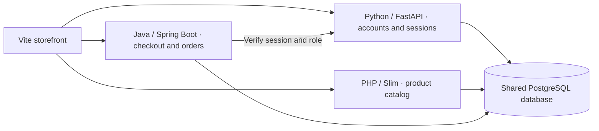

# Apex E-Commerce

A demo storefront with three backend services. Customers can browse products, sign in, and place demo orders. Administrators can view orders and update their status.

[Open the storefront](https://apex-ecommerce-aditya.vercel.app/) · [Architecture details](ARCHITECTURE.md) · [Deployment and testing](docs/DEPLOYMENT.md)

I developed the **Java and Spring Boot order service**, which verifies sessions through the users API and stores orders in PostgreSQL. The demo stores accounts and orders and does not collect payments or arrange deliveries.

## Architecture



1. The users service issues a session after sign-in. The storefront sends it with checkout and order requests.
2. The order service verifies the session and reads product prices from the database. It locks the relevant stock rows, calculates the total, and saves the order and stock changes in one transaction.
3. Customers can read their own orders. The order service checks the administrator role before allowing access to admin actions.

Docker Compose runs the local stack. The hosted layout uses Vercel for the storefront and Render for the three APIs and PostgreSQL. The [deployment guide](docs/DEPLOYMENT.md) covers configuration and first startup.

## Run locally

Install Docker with Compose. Copy [`.env.example`](.env.example) to `.env`, then run from the repository root:

```sh
docker compose up --build
```

Open the storefront at http://localhost:5173. The local users API docs are at http://localhost:8000/docs. See the [deployment guide](docs/DEPLOYMENT.md#accounts-and-orders) for setting up a local admin account.

## Verification

The [HTTP integration test](tests/integration.py) covers login, catalog access, order creation, server-calculated pricing, customer isolation, and admin authorization. Run it against an isolated stack because it creates test accounts and a demo order. See the [test commands](docs/DEPLOYMENT.md#verification).

## Screenshots

<details>
<summary>Storefront, cart, and order management</summary>


</details>
